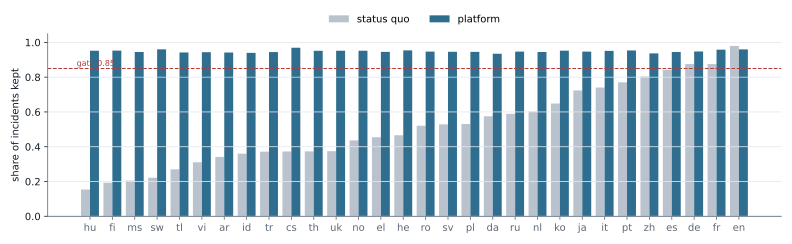
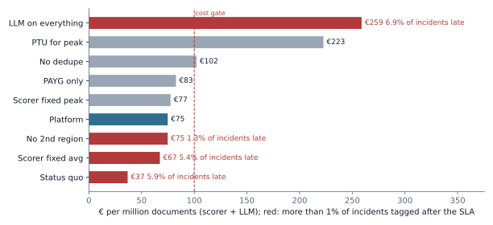
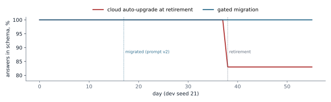
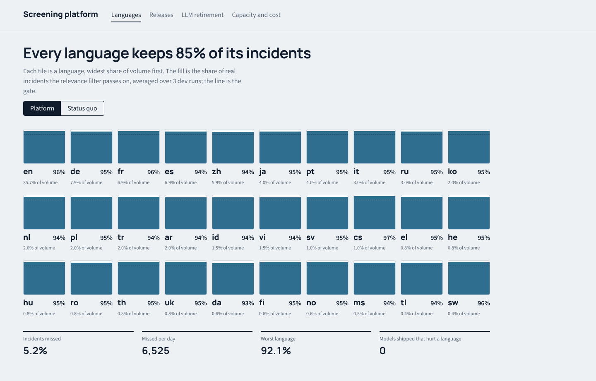
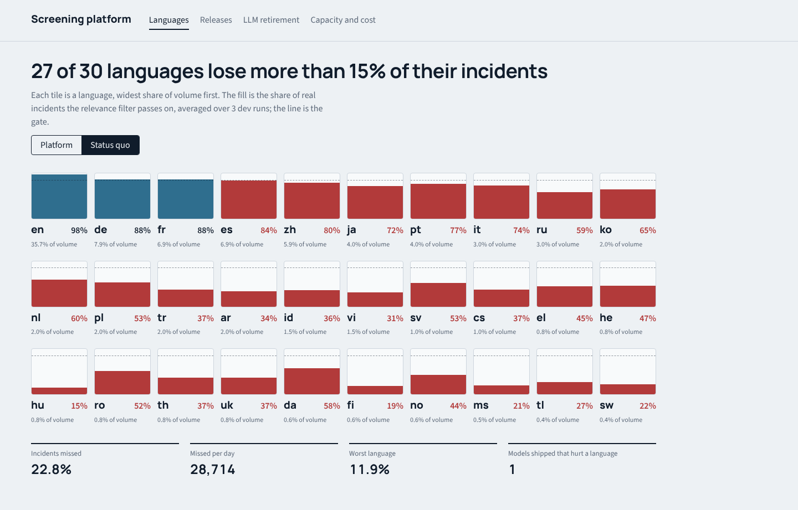
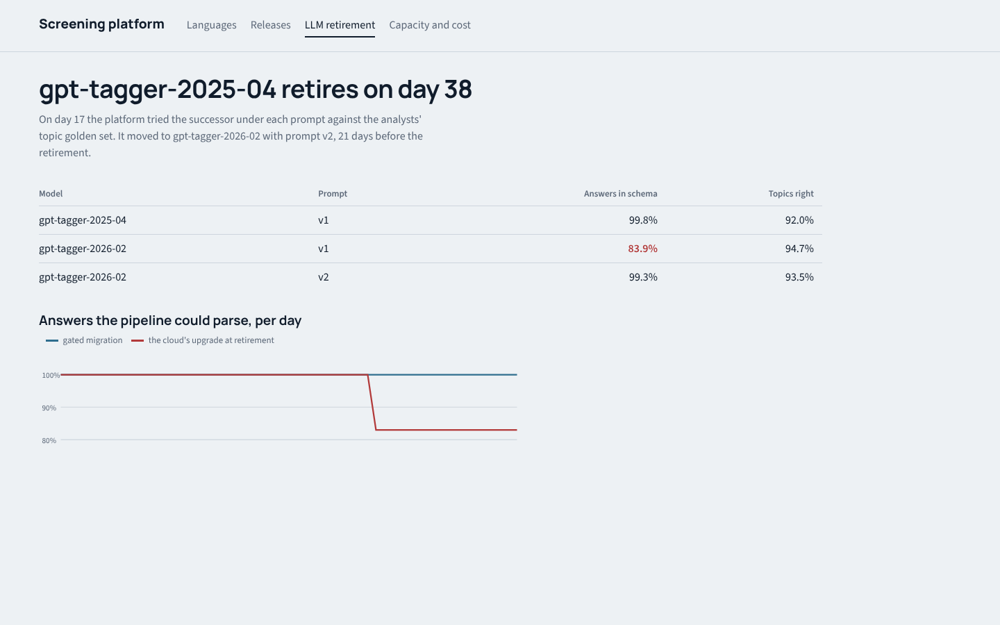

# risk-screening-ml-platform

This is the ML platform behind a news-screening pipeline that reads 2.5 million documents a day in 30 languages and
finds the ones that describe a company's misconduct: pollution, fraud, child labour, data breaches. It runs on
Azure. Its job is to:
- keep the relevance model as good in Swahili as in English;
- catch a broken label export before a model trains on it;
- notice when a new source changes a language;
- tag incidents within hours during news spikes;
- move off an LLM version before the cloud retires it, without breaking the output format.

The stack:
- **Pipeline:** Event Hubs (Kafka protocol), a relevance scorer on AKS scaled by KEDA, Azure OpenAI tagging
  (provisioned throughput plus pay-as-you-go in two regions), Azure ML.
- **Access:** Entra ID workload identity, and an LLM gateway that maps Entra groups to deployments, quotas and
  budgets.
- **Infrastructure:** Terraform and Kustomize.
- **Code:** a Python platform package, and a React console.

I built this for the RepRisk Senior Machine Learning Platform Engineer application. The traffic, labels and LLM
behaviour are simulated, and the simulation keeps its own truth, so every number below is measured against what was
really true. See [Limits](#limits).

## Results

<!-- results:start -->
Generated by `make report` from `reports/dev.json` (dev seeds 21, 22, 23; mean over seeds, ± half a 95% interval; gates judged on the worst seed). The held-out world has not been run yet.

### Release gates (platform)

| gate | threshold | dev (worst seed) | held-out |
|---|---|---|---|
| worst language recall | ≥ 0.85 | 91.8% ✅ | not run |
| missed incidents | ≤ 0.08 | 6.0% ✅ | not run |
| bad promotions | ≤ 0 | 0 ✅ | not run |
| sla | ≤ 0.01 | 0.0% ✅ | not run |
| cost | ≤ 0.1 | €0.082 ✅ | not run |
| retirement | ≤ 0 | 0 ✅ | not run |
| drift | ≤ 3 | 0 d ✅ | not run |

### Designs on the same luck (dev)

| design | worst language recall | incidents missed | incidents tagged late | incidents untagged | € per 1,000 docs | bad promotions | drift noticed after |
|---|---|---|---|---|---|---|---|
| Status quo | 11.9% ±2.0 | 22.8% ±0.6 | 5.9% ±5.8 | 5.6% ±0.7 | €0.037 | 1.3 | never |
| LLM on everything | 100.0% | 0.4% | 6.9% ±6.3 | 0.7% ±0.7 | €0.259 | 0.0 | 0.0 d |
| Platform | 92.1% ±0.3 | 5.2% ±0.9 | 0.0% | 0.7% ±0.7 | €0.075 | 0.0 | 0.0 d |

Per day that is 28,714 incidents missed by the status quo against 6,525 by the platform, at €91 and €185 a day. Running the LLM on everything costs €640 a day.



### Ablations: the platform with one part changed (dev)

| design | worst language recall | incidents missed | incidents tagged late | incidents untagged | € per 1,000 docs | bad promotions | drift noticed after |
|---|---|---|---|---|---|---|---|
| nothing (platform) | 92.1% ±0.3 | 5.2% ±0.9 | 0.0% | 0.7% ±0.7 | €0.075 | 0.0 | 0.0 d |
| labels allocated by volume (no floor for small languages) | 91.2% ±1.1 | 5.1% ±0.6 | 0.0% | 0.7% ±0.7 | €0.081 | 0.0 | 0.0 d |
| one threshold for every language | 5.8% ±5.1 | 23.2% ±1.1 | 0.0% | 0.7% ±0.7 | €0.035 | 0.0 | 0.0 d |
| retraining on the latest export alone, without the data contract | 91.4% ±2.0 | 5.2% ±1.1 | 0.0% | 0.7% ±0.7 | €0.092 | 0.7 | 0.0 d |
| the same, and an aggregate gate instead of the per-language one | 91.1% ±1.8 | 5.4% ±0.9 | 0.0% | 0.7% ±0.7 | €0.090 | 0.0 | 0.0 d |
| drift alerts without a targeted retrain | 90.4% ±2.5 | 5.2% ±0.9 | 0.0% | 0.7% ±0.7 | €0.074 | 0.0 | 0.0 d |
| no near-duplicate removal | 92.1% ±0.3 | 4.8% ±0.9 | 0.0% | 0.7% ±0.7 | €0.102 | 0.0 | 0.0 d |
| pay-as-you-go only (no provisioned throughput) | 92.1% ±0.3 | 5.2% ±0.9 | 0.0% | 0.7% ±0.7 | €0.083 | 0.0 | 0.0 d |
| provisioned throughput sized for the peak hour | 92.1% ±0.3 | 5.2% ±0.9 | 0.0% | 0.7% ±0.7 | €0.223 | 0.0 | 0.0 d |
| no second region for throttled calls | 92.1% ±0.3 | 5.2% ±0.9 | 1.3% ±1.9 | 0.7% ±0.7 | €0.075 | 0.0 | 0.0 d |
| scorer replicas fixed at the average load | 92.1% ±0.3 | 5.2% ±0.9 | 5.4% ±5.4 | 0.7% ±0.7 | €0.067 | 0.0 | 0.0 d |
| scorer replicas fixed at the peak load | 92.1% ±0.3 | 5.2% ±0.9 | 0.0% | 0.7% ±0.7 | €0.077 | 0.0 | 0.0 d |
| letting the cloud upgrade the LLM at retirement | 92.1% ±0.3 | 5.2% ±0.9 | 0.0% | 5.6% ±0.7 | €0.075 | 0.0 | 0.0 d |



### Releases on dev seed 21

Platform:

| day | trigger | decision | why |
|---|---|---|---|
| 0 | initial | promoted | first model |
| 14 | schedule | promoted | every language holds its recall |
| 30 | drift in id | promoted | every language holds its recall |
| 42 | schedule | promoted | every language holds its recall |

Status quo (aggregate gate, newest export only):

| day | trigger | decision | why |
|---|---|---|---|
| 0 | initial | promoted | first model |
| 14 | schedule | promoted | aggregate F1 +0.013 |
| 42 | schedule | promoted | aggregate F1 +0.002 |

What the status quo shipped on day 14, true recall before → after: es 82%→76%, pl 70%→50%, id 38%→28%, cs 57%→35%, fi 13%→7%, no 44%→37%.

Label exports the platform caught: day 14: el 0/700, he 0/700, th 0/700, tl 0/700, sw 0/700 (requested again); day 42: el 0/700, he 0/700, th 0/700, tl 0/700, sw 0/700 (requested again).

### LLM retirement (dev seed 21): gpt-tagger-2025-04 retires on day 38

Evaluated on day 17; decision: gpt-tagger-2026-02 with prompt v2.

| model | prompt | answers in schema | topics right |
|---|---|---|---|
| gpt-tagger-2025-04 | v1 | 99.8% | 92.0% |
| gpt-tagger-2026-02 | v1 | 83.9% | 94.7% |
| gpt-tagger-2026-02 | v2 | 99.3% | 93.5% |



Deduplication caught 90.9% of syndicated copies and merged 0.41% of different stories. The planner bought 12 provisioned units; the scorer averaged 1.06 pods. Cost per day: scorer €5, payg €47, ptu €133.
<!-- results:end -->

## How it works

```
Event Hubs (Kafka)                AKS (KEDA on consumer lag)                Azure OpenAI
documents-raw ──► dedupe (SimHash) ──► documents-unique ──► relevance scorer ──► documents-relevant ──► tagger
                                                         ONNX model + per-language        PTU base ─► PAYG primary
                                                         thresholds, /metrics                      ─► PAYG secondary
                                                                                                     │ parse: schema
                                                                                                     ▼ or retry/person
                                                                                              documents-tagged ──► analysts

Azure ML / platform package (src/screening)
  labels: floor per language + incident-enriched ─► data contract on the export ─► train ─► thresholds (calibration)
  ─► per-language gate (test half, intervals) ─► ONNX + thresholds ─► image ─► canary ─► stable
  drift watch: score PSI and volume share per language ─► targeted labels ─► retrain ─► gate
  capacity: KEDA lag rule; cost-optimal PTU units for the demand forecast
  lifecycle: retirement calendar ─► successor × prompt variants on topic golden set ─► migrate early or escalate
  gateway: Entra group ─► allowed deployments, tokens per minute, monthly budget
```

Decisions are written up as ADRs in [docs/adr](docs/adr):
- the per-language gate;
- the label floor and per-language thresholds;
- the data contract on label exports;
- provisioned throughput with spillover;
- gated LLM migration;
- the held-out world.

## Console

A React console (Vite, Framer Motion) reads `web/public/console.json`, which `make report` writes. It has four views:
- **Languages:** a gauge per language, status quo against platform.
- **Releases:** promotions and holds, with the gate's reasons, the broken exports it caught and the drift alerts.
- **LLM retirement:** the successor under each prompt, and parsed answers per day.
- **Capacity and cost:** what each design spends and how late it tags.





## What the role asks for and where it is

| The posting asks for | Where it is here |
|---|---|
| Feature pipelines, automated data creation, ETL | `screening/platform.py`: label allocation, the data contract, golden sets, drift relabelling; `screening/text.py`: dedupe |
| Design, test, deploy and monitor production NLP models and endpoints | `screening/models`: training, thresholds, gate, ONNX export; `screening/serving/app.py`: FastAPI and ONNX Runtime with Prometheus metrics; `deploy/k8s`: stable and canary tracks |
| CI/CD and cloud infrastructure, with cost in mind | `.github/workflows/ci.yml`: tests, Terraform validate, kubeconform, image build and a kind smoke test; `infra/terraform`: AKS, Event Hubs, ADLS Gen2, Azure ML, Azure OpenAI in two regions, Key Vault, Postgres, monitor alerts |
| LLM lifecycle, access and deployment | `screening/lifecycle/retirement.py`; `screening/llm/gateway.py` (Entra groups to deployments, quotas, budgets); `NoAutoUpgrade` deployments in `openai.tf` |
| Azure ML, Azure OpenAI, AKS, Data Lake, Entra ID | `infra/terraform/*.tf`; workload identity in `identity.tf` and the Kubernetes service account |
| Debugging computational bottlenecks | `screening/capacity/autoscale.py`, and `evals/operate.py`, which turns spikes into scorer backlog, LLM throttling and SLA delay |
| Agentic AI deployment patterns | the retirement agent (the model's answers are judged by code, and a person decides when no variant passes) and the gateway in front of every LLM call |

## Run it

```bash
make install      # Python dependencies
make test         # unit tests, a short platform run, the scorer API, ONNX parity
make eval         # every design on dev seeds 21, 22, 23 -> reports/dev.json
make report       # README results, docs/charts, web/public/console.json
make image        # trains the day-0 model, builds the scorer image (ONNX Runtime + FastAPI)
cd web && npm install && npm run dev    # the console
```

Infrastructure:
```bash
cd infra/terraform && terraform init -backend-config=... && terraform plan -var-file=example.tfvars
kubectl apply -k deploy/k8s/overlays/aks
```

## Limits

- **Simulated traffic, labels and LLMs.** The documents are written in synthetic languages: each language has its
  own words for the same concepts, and related languages share part of them. Real text is messier, and real
  multilingual transformers transfer across languages better than this.
- **A stand-in model.** The relevance model is TF-IDF with logistic regression, so every design can retrain in
  seconds on the same luck. The scorer's throughput in the capacity numbers is an assumption for a distilled
  transformer (40 documents per second per pod), not the stand-in's 34,000.
- **Assumed prices and quotas.** Pay-as-you-go and provisioned throughput prices, quotas and throttling rates are
  assumptions in config and the world. The planner's choice changes with your contract.
- **Not deployed to Azure.** The Terraform is validated in CI, not applied to a subscription. The Kubernetes
  manifests are schema-checked, and the scorer runs on kind in CI.
- **A flattered baseline.** "LLM on everything" is assumed to find every incident.
- **Tuned on dev.** The dedupe distance, label floor, threshold target and drift thresholds were set on dev seed 21,
  as noted in `config/platform.toml`.

## Repository

```
config/         platform.toml (product), gates.toml, designs.toml; world.toml and heldout.toml (simulation only)
world/          the simulated market and its truth; nothing in src/ imports it
src/screening/  models (train, thresholds, gate, ONNX), serving (FastAPI), capacity, llm (tagging, gateway),
                lifecycle (retirement), monitoring (drift), platform.py (the daily control loop), text.py (dedupe)
evals/          truth, operations physics, designs on the same luck, README and console generators
infra/terraform Azure: AKS, Event Hubs, ADLS Gen2, Azure ML, Azure OpenAI x2, identities, Postgres, alerts
deploy/k8s      Kustomize base, AKS overlay with KEDA, canary overlay, kind overlay for CI
web/            React console: languages, releases, LLM lifecycle, capacity and cost
docs/           ADRs, assumptions, held-out protocol, charts, screenshots
```
